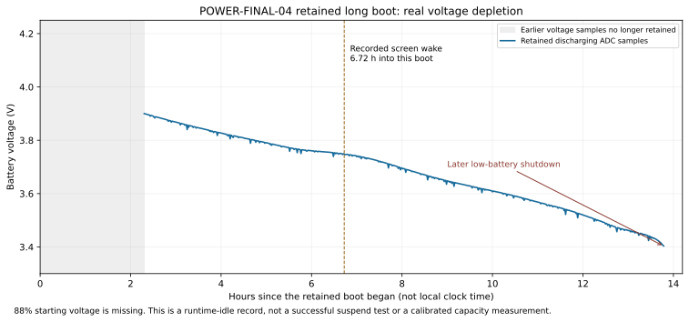

# Y2 Platform 1.0 — final deep-sleep investigation

Investigation opened 2026-10-07; **IN PROGRESS, no readiness promotion**.
**Latest, morning 2026-10-08: DEEPSLEEP-FINAL-03 failed its automatic suspend
attempt and rebooted without owner intervention.** Archive66 preserves the
read-only SSH retrieval. The owner reports approximately six unplugged hours,
about88% at removal and55% in the morning; retained pre-cable samples confirm
88% and55%. Boot0132fb21 attempted kernel suspend at BOOTTIME398.407s, then
ends at retained DPM_PREPARED/sequence8. Boot81dce40c records the prior shutdown
unclean, no full-system suspend and380 recovery-guard refusals. Exact reset
cause is unknown. Runtime CPU0 DORMANT worked, but the overnight system-sleep
objective failed. The pending03 guard remains intact.

Morning health is responsive/paused, PCM closed, no scan, Wi-Fi/BT off, taint0,
ext4 errors/warnings0 and charging without reported faults. Installed03 sources
and four file hashes still match archive65. No device mutation or new trial.
See [§32](#32-overnight-result--2026-10-08) and the
[machine summary](data/y2-deepsleep03-overnight-20261008.json) for endpoints,
clock limitations, evidence hashes and the recurring pre-SPM failure. These
findings supersede the pre-observation NOT_RUN status below; controlled
30-minute/two-hour/endurance acceptance and independent reliability gaps remain
open.

**Previous checkpoint:03 passes quick installation verification (archive65).**
Linux `cfb7e098eae60918f47d7b330445bf66e9d61817`, Reborn
`97ff8c357bab12319087740d7c97b5051e6588f5`, rootv1.33 and kernel03 are verified
on boot `0132fb21-8462-4f77-9faf-3a7e7f1b8429`. Reborn and three changed helpers
match build hashes, taint0, first frame and status healthy, USB configured,
charging active without reported faults, ext4 errors0. Archive65 preserves
first-return/pstore/SRAM/persistent logs before further reads;18/18 installation
checks pass. No device mutation, new test or agent flash.

Automatic sleep policy is installed, synthetic USB-budget wake source removed,
physical cable/battery wake enabled, operation owners clear, old02 guard identity
inapplicable. No RTC alarm/test/backstop is active. **03 SPM entries/resumes0:**
USB is connected, so this quick check does not qualify suspend or endurance.
The owner intends to leave it unplugged overnight; no actual start is recorded.
Morning reconnect must preserve evidence before reboot. Connected88% provisional
SOC is not a drain endpoint. Controlled30-minute/two-hour and independent
reliability/electrical gaps remain open. Software qualification remains578
platform cases,335 Reborn tests plus fmt/Clippy/ARM/kernel/ABI/QEMU/package PASS.

**Stopped for the day at the owner's request, 2026-10-08.** Archive62 records
an interrupted thirty-minute trial: 943.163696289 seconds actual full suspend
across two same-boot returns, including one dark/radio-off maintenance wake
and automatic re-entry. USB reconnection ends the second cycle. SPM8→10,
taint0, COMPLETE667/error0, Reborn restored, ext4 errors0. This is not a
thirty-minute pass or qualified drain endpoint. Archive63 confirms no test,
RTC alarm or recovery timer remains active; product quarantine is restored.
USB and charging work. No further test or deployment tonight.

Earlier boundary: archive59 passes the normal automatic product path after the
recorded0ba99f5 single-write correction and narrow runtime USB-budget wake fix.
One203.051331-second SPM interval returns through RTC on boot `f567b2c3...`,
taint0, COMPLETE573, Reborn restored, no filesystem errors. Named maintenance
inhibition and automatic entry after release pass. Earlier exact02 has six clean
owner-qualified returns, Power2/2 and RTC4/4, including305.200562 seconds asleep
(47–50), with post-resume audio/storage checks. Trial53's false failure/replayed
command and56's three pre-SPM refusals remain preserved failures. Next session
must qualify the local maintenance correction before repeating the30-minute
normal-product measurement; original intermittent
device reset, warm-start display, poweroff and longer endurance remain open.
Owner target: real system suspend and approximately <=1 percentage point per
normal night if the hardware permits. Voltage/current safety policy and SOC
scaling are unchanged. No autonomous flash. Screen-off, runtime C1/C2/C3 and
whole-system suspend are separate evidence categories throughout this report.

Authoritative continuation: [newest handoff](../planning/NEXT-SESSION-HANDOFF.md),
then [boundary audit](../planning/roadmap-gap-audit.md#deep-sleep-continuation-admission--2026-10-07).
The handoff's earlier installed-device assumption is superseded by fresh SSH.
Private raw evidence: `out/deep-sleep-final/evidence/20261007/00-initial/`.
Archives and SHA256 receipts stay local; no private logs are published.

## 1. Installed firmware

**Current: DEEPSLEEP-FINAL-04** (owner flashed 2026-10-08, archive68): Linux `5e267571d584da7fbe356d3161801ba15f87fa57`,
Reborn `97ff8c357bab12319087740d7c97b5051e6588f5`, kernel `6.18.0-y2linux-platform-v1-deepsleep-final-04`, root v1.34, release
`1.0.0-platform-v1-deepsleep-final-candidate.4`, taint 0; installed Reborn and the three PM helpers match the build byte-for-byte
(Reborn `0de80494f27f849471dd230b27fcc853072cc116014e950a881f57889bd84ad4`; its hash differs from 03's `890216e0…` although the Reborn
source is unchanged, so Reborn builds are not byte-reproducible here). See §39. The 03 text below is retained as history.

**Current: DEEPSLEEP-FINAL-03**, rechecked by SSH in archive66 on2026-10-08.
Current boot `81dce40c-9bb5-4f14-8465-c7e80ba3c602` follows an unclean end of
installation-check boot `0132fb21-8462-4f77-9faf-3a7e7f1b8429`; see §32. Kernel
`6.18.0-y2linux-platform-v1-deepsleep-final-03`, release
`1.0.0-platform-v1-deepsleep-final-candidate.3`, root2025.02.18-platform-v1.33.
Linuxcfb7e09 / Reborn97ff8c3; live Reborn SHA
`890216e09b6de5a19796912e11db4ec831183d713c2c4c0a6669fd4ffe785423` matches
sealed build. The product/journal/receipt helpers also match03; historic02 live
ledger files remain data evidence only. The paragraphs below retain02 history.

Previous02 boot was `f567b2c3-97eb-42e2-8c24-ffca801be25c`, exact02 after owner
hardware restart. Archive `45b-clean-hardware-return/` records uptime 397.88 s,
taint zero, advancing display vblanks 17/87/154/222, no diagnostic module and
owner-confirmed normal player. Battery ADC 4.095922 V while connected is not
a discharge-test endpoint. Clean PM stages plus Power wake with RTC300 fallback
return under `/data/logs/deepsleep-clean-f567b2c3-452` (archive47).
Archive54 then deploys the unbuffered product PM fix from0ba99f5: one Python
file, SHA72651d6f6366b7d58a8e80cac9e5681acb00ab4e7eb0315016ac4cc1789d72da,
with durable original backup and an explicit live-overlay ledger. Image, kernel
and Reborn identity stay unchanged; sealed02 does not contain this correction.
Archive57 disables wake permission only on the synthetic USB current-budget
supply; physical wake owners and all charger limits remain unchanged. Archive59
qualifies that runtime policy and the Python overlay narrowly. Neither correction
is present in the sealed02 image. Product quarantine remains between trials.

The preceding service reboot to remove the observer produced boot
`7c416e45-c90c-4fbc-9715-237792b37105`, with the same early display failure and
taint512 before any new PM trial. Archive44 retains it. The failed OVL recovery
module is excluded from further testing.
At that earlier point the installed image remained02. The paragraphs below retain
the preceding diagnostic boot and original image-verification evidence.

Earlier boot `22bd28fa-62ed-4e1e-afe4-0e6c6e209ac7` followed owner hardware
restart. Archive `38-display-hang-reboot-return/` records uptime 46.41 s,
taint zero, normal display IRQs and Charging at 4.131518 V. The exact matching
stack observer later adds taint4096. Archive `40-device-wait-clean-display-return/`
shows successful freezer/device returns with working display and no new warning
or filesystem errors; no blocked tasks were sampled. The intermittent clean
device-stage failure remains open. Archive42 then records all five stages and
one real RTC return, COMPLETE seq197, 803768 SPM ticks (24.529052734 s).

Earlier boot `e6b85337-2662-4e12-8264-a4c787c53447` followed the archived
service reboot used to replace a non-unloadable diagnostic module. Boot display
warnings contribute taint 512 before loading; the refined matching observer
adds 4096 (total 4608). It changes no hardware or CPU context callbacks. Its
latest trial returns from freezer but fails Reborn restoration before devices.
The earlier clean trial used taint zero through freezer return/device entry.

Current SSH-verified image is **DEEPSLEEP-FINAL-02**: release
`1.0.0-platform-v1-deepsleep-final-candidate.2`, root
`2025.02.18-platform-v1.32`, kernel `6.18.0-y2linux-platform-v1-deepsleep-final-02`,
Linux `5a32683f1ae9493c6a37bd18af3d131afb04d450`, Reborn 0.2.0/source
`5a9f7586dd8d80ab5afc16c6a9a7e853e7469aeb`. Initial uptime 46.24 s, taint 0,
boot `f350d9dd-5126-4d89-b8f0-9f09cb1603f7`. Metadata matches the sealed 02
manifest; no partition readback hash is claimed. USB configured, clock gates/
restores 1/1, failures 0; BAT0 Charging and voltage rises 4.076806→4.128442 V
during the connected observation. SDP ceiling 450000 uA is programmed, not
measured battery current. SPM entries/resumes are still zero before testing.

Archive `26-successor02-initial/` preserves all retained state and the saved 01
export. Export boot `44c73d7b-7e24-464d-b80f-3279691cd206` confirms Linux
`0c9b78c7903182861b84e7d90a536bd30fca295a`, root v1.31 and Reborn `5a9f758`.
Rotated system log records successful initial recovery followed by USB
`stopped stage=2 result=-5 IRQ=0`, matching the omitted CCF ownership claim.
The export contains no configured gadget and no full SPM entries; its raw
suspend receipt is explicitly from older boot `404ef43c...`, not 01 success.

The table below is the **initial installed 04 identity**, retained to attribute
the overnight investigation and diagnostic measurements correctly.

Fresh exclusive-lock SSH, initial uptime 638.83 s, kernel taint 0:

| Field | Installed value |
| --- | --- |
| Release | `1.0.0-platform-v1-power-final-candidate.4` |
| Build | `Y2LINUX-PLATFORM-V1-POWER-FINAL-04` |
| Kernel | `6.18.0-y2linux-platform-v1-power-final-04` |
| Root | `2025.02.18-platform-v1.30`, Buildroot 2025.02.18 |
| Linux source | `5aeba051c428451483402e5874dcf8222afca259` |
| Reborn | `0.2.0`, source `8cd365da5f3454c8e3189df1434b966edbd06575` |
| Boot ID | `dbcb3854-d028-4882-94aa-cc86b5af091e` |

Installed metadata matches candidate 04 and its newest owner handoff; this is
not a readback hash of the installed partitions. Current Linux documentation
baseline `3e562e7` follows that implementation without changing it. Both working
branches are `codex/platform-v1-deep-sleep-final`. No stale power worktree used.
After the first idle collection, four userspace instrumentation files were
deployed with before/after hashes and a durable backup under
`/data/logs/deepsleep-final-userspace-backup-dbcb3854`. The kernel and Reborn
remain installed 04. Boot capture changes activate on the next boot; suspend
receipt calls use the improved journal immediately. No service was restarted
and SOC state was not reset for this deployment.

## 2. Overnight 88% → 30% incident

Owner observed ~58 displayed percentage points lost in ~6 hours on the most
recent tested night, then charged briefly and turned the device off. Do not
rewrite this account as an observed morning low-battery shutdown. Retained long
04 boot `74a4645d-de94-46c5-8457-8a46b01c6cc1` contains a ~6.72 h screen wake
and a later ~13.8 h low-battery shutdown, followed by charging/user-shutdown
boots. Exact local-time mapping is unavailable: the device uses build-floor
wall time and RTC was in 2022. Boot IDs and monotonic intervals are authoritative.

## 3. Retained evidence recovered after reboot

Archived `/data/logs`, `/data/system/platform`, prior CPU qualification,
Reborn logs/diagnostics/state and installed power/version configuration before
any trial. Successful raw archives: `retained-evidence.tar` and
`pstore-reborn.tar`, each with a SHA256 receipt. The failed initial compressed
archive attempt is retained as a failed command, not counted as evidence.

`/sys/fs/pstore` existed but was **unmounted**. Explicitly mounting pstore
recovered `console-ramoops-0` (222 bytes) and `dmesg-ramoops-0` (60,771 bytes).
Both were copied without deleting the kernel entries. Some bytes are visibly
corrupted; do not interpret damaged text as a trustworthy register value.

Current retained SRAM journal: `valid=0`, stage NONE, no previous device ring;
this does not prove there was no earlier warm-reset attempt. No persistent
journald exists; `/var/log` is volatile and BusyBox syslog persists under
`/data/logs`. Boot history, suspend receipt, power journals and Reborn JSONL
survived. Four invalid Reborn JSONL lines are preserved, not parsed as facts.

## 4. Reset / shutdown evidence

The long boot's power journal records five critical-voltage samples then
`shutdown_execute`, reason `low_battery`, near 3.400 V. Later charging boot
`7e94bd22-ea3f-41b7-ac2e-3e1726685403` ends with user poweroff.

The surviving panic belongs to the **later short user-shutdown boot**
`d1a8b50d-b525-4ff8-aaf8-e0d24dac97cb`: Power down at 88.82 s,
`mt6323_do_pwroff` warning at 89.82 s, “Unable to power off system”, then
“Attempted to kill init” panic at 90.82 s. It is a separate poweroff defect,
not evidence that suspend panicked during the six-hour window. Boot journal
`shutdown_complete` proves userspace shutdown preparation, not electrical off.
RGU raw status zero / `none_reported` is inconclusive, not proof of a power-on reset.

## 5. Battery voltage / SOC interpretation

Retained system log has 690 consecutive minute-spaced discharging-voltage samples,
from 3.900146 V at 8,281.84 s (~2.3 h) to 3.403564 V at 49,621.84 s; the final
battery journal then reaches ~3.400 V near 49,670 s. Around the observed
morning wake, voltage is ~3.74–3.76 V. Charger source/current allocation are zero
and faults zero in these rows. This is actual depletion; SOC imperfections
cannot explain away the sustained voltage decline. No measured battery mA exists.

Power JSONL rotation lost the starting 88% row. Surviving long-boot rows cover
38,899.8–49,674.6 s: 3.576928 V / 9% to 3.399609 V / 0%. Initial 88% voltage,
charge termination and exact six-hour endpoint cannot be recovered from these
rows. Voltage under load is not a calibrated capacity measurement.

The [voltage-only CSV](data/y2-deep-sleep-retained-voltage.csv) retains source
line numbers; [provenance](data/y2-deep-sleep-retained-voltage.json) records the
private source-log hashes. No missing 88% voltage or local timestamp is invented.

## 6. Normal product power policy

Installed `sleep.request()` always refuses with `charger_active` or
`physical_qualification_required`; there is no ordinary auto-suspend transition.
Paused short Power attempts that guarded request, then blanks the screen after
refusal. Playing short Power blanks. Dark short Power wakes the display; long
Power presents shutdown confirmation. Screen-off remains runtime idle at
1/5/30 minutes and hours. Full sleep is only the explicit owner helper.
Thus the product does not enter full suspend overnight by itself.

## 7. C1

Long-boot retained 10,774 s interval: CPU0 WFI ~5.92% residency. Current 60.30 s
unplugged window: CPU0 WFI 98.60%, four CPUs online, C2/C3 zero. The following
300.28 s window transitions from four CPUs to CPU0 only: WFI 37.65%. A secondary
CPU's endpoint WFI delta exceeds wall time across hotplug; that secondary
residency is invalid, not >100% useful residency.

## 8. C2

Same retained interval: CPU0 SLIDLE ~85.57%. This is runtime idle with Linux
services and timer wakes, not whole-system sleep. Current five-minute window:
SLIDLE 2.98% (2,403 entries).

## 9. C3

Long-boot cumulative DORMANT usage and time remain **zero**, including the final
snapshot. Therefore this boot never entered C3 before the observed endpoints.
The clock veto is PERI `1024` = bit 10, the USB bus clock. Radio, display/GPU,
audio and storage runtime states do not explain that particular clock bit.
Current five-minute post-USB-detach window: DORMANT **55.82%, 8,301 entries**,
without changing policy. USB bus gate is verified off, failures zero; early
window includes SMP residency before automatic CPU parking. The owner reattached
USB after ~21 minutes, interrupting the thirty-minute window. Only 60 s/300 s
are valid complete windows from that first collection. The later complete
30-minute follow-up is recorded in section 10 with its diagnostic taint explicit.

## 10. C3 normal-boot policy

Current and retained normal policy: Enabled, budget `-1`, C3 disable `0`.
No manual enabling was done. This is an entry veto, not a disabled production
policy. Source establishes a missing clock owner on a no-cable cold boot:
USB probe enables its bus clock, but registers a MUSB child only after a valid
data-source attach. Without a child there can be no child runtime suspend to
release that clock. After an actual USB session, detach follows a different
path. The running unplugged test deliberately measures that distinction.

### Complete thirty-minute runtime observation

`20-idle30-return/` completes **1800.282208723 s** without SSH, playback, scan,
USB or radios. Screen remains off, same boot `404ef43c...`, no system suspend
requested. External context/retained-console modules remain loaded (taint 4096),
so this complements rather than replaces the earlier untainted baseline.
CPU0 C1/C2/C3: **37.6814 / 2.0512 / 56.7212%**, entries
19,315 / 13,095 / 49,755. CPU0 idle exits 45.6401/s. CPU topology changes 0–3→0,
so per-IRQ whole-system rates are unknown; `/proc/stat` totals remain valid:
**77.2957 interrupts/s, 136.3142 context switches/s**. CPU0 IRQ lower bounds:
GPT 34.8057/s, architectural timer 12.6825/s. 598 MHz residency 98.1814%.
BAT0 active/event +30, wakeup_count +0; other registered sources unchanged.

Fresh voltage **4.062963→4.030664 V**, −32.299 mV; daemon SOC **91→85%**.
Separate daemon ADC samples 4.054614→4.032202 V; never mix these with the fresh
endpoint series. Charging relaxation is still a limitation. This independently
shows the estimate can exceed 88%; it does not recover the missing start-of-night
charge/voltage record. Primary worker switch rates: events_freezable 27.6168/s,
RCU 7.2516/s, secondary freezable worker 5.3486/s, charger 4.8115/s,
idle-demand 2.6263/s, power daemon 2.2646/s, audio 2.2346/s, Reborn main 2.1486/s.
These are context-switch rates, not asserted unique hardware wake rates.

Raw SHA256: first-return.json `dfdb28df8d516397a88c21acae643fc2420240b7278390649bdba248aec1eca3`;
retained-sysfs.tar `6cd92d9777db9a8bf1561126d66446bf4b73f4df35caa9065da0ea4b87ecba00`;
persistent.tar `f76b664ca24895a744202475a0449ae54f59393796d94b0ed7267705f576686f`.

## 11. Wakeup sources

Current five-minute window: 79.00 total IRQ/s, 138.65 context switches/s;
registered wakeup sources show BAT0 event/active count +5 (periodic notification),
all wakeup_count deltas zero and other sources unchanged. Kernel endpoints do
not expose independent unique CPU wakes; do not relabel context switches as
measured wakeups. C3 did enter despite these runtime events.

## 12. IRQ offenders

| Five-minute IRQ source | CPU0 lower bound/s | Interpretation |
| --- | ---: | --- |
| IRQ24 / SYSIRQ112 `timer@10008000` | 38.45 | GPT clockevent, including scheduled work; exact worker attribution below |
| IRQ25 arch timer | 14.19 | CPU0 clockevent; other CPU columns disappear during hotplug |
| IPI3 function call | 1.95 | CPU0 interprocessor work |
| IPI5 IRQ work | 1.62 | CPU0 IRQ work |
| IRQ221 / SYSIRQ40 `11240000.mmc` | 0.96 | SD host |
| IRQ220 / SYSIRQ39 `11230000.mmc` | 0.55 | eMMC host |
| USB, AFE, Wi-Fi/BT, input, RTC | 0 | No CPU0 IRQ delta in this window |

Reanalysis preserves the original raw endpoints and records a new
`B300-hotplug-aware-summary.json`. The CPU header changes from four CPUs to one:
subtracting aggregate columns can silently undercount even if the difference is
positive. Whole-system per-IRQ rates are therefore unknown for this window;
the table reports common CPU0 counters only. `/proc/stat` total IRQ/s remains
valid. The unchanged-header 60-second window has whole-system arch timer
59.75/s, GPT 24.76/s, function-call IPI 10.51/s, SD 0.96/s, eMMC 0.83/s.

The earlier all-core 60 s window had arch timer 59.75/s, GPT 24.76/s,
function-call IPIs 10.51/s and total IRQ 97.91/s. CPU parking therefore matters.

## 13. Userspace offenders

Retained Reborn log: paused startup, dark screen except brief user interaction,
no overnight scan/playback activity. Installed 04 includes the earlier blocking
connectivity supervisor fix. Current five-minute context-switch ranking:
freezable CPU0 worker 30.29/s; RCU 7.42/s; CPU2 worker 6.25/s; charger worker
4.81/s; idle-demand worker 2.61/s; power daemon 2.40/s (~1.14% one CPU);
Reborn watchdog 2.05/s, playback 2.01/s, audio 1.99/s. Other workers remain in
the raw endpoint audit. These are context-switch rates, not unique wake counts.
Source review finds database/scanner one-second receive-timeout loops and
paused audio/playback timer waits; exact fixes and remeasurement remain pending.

## 14. Audio / DAC power

Installed 04 includes idle-bias-off fix. Current same-boot readback after cable
return: PCM closed, codec and AFE runtime suspended, all three DAPM biases Off,
GPIO15/18/20 output low, audio/AFE bus clocks count zero, AFE IRQ count zero.
The upstream VGP2 audio supply has enable count 1 at 1.8 V while downstream
DAC enables are off; do not claim every analog supply is electrically off.

## 15. Display / GPU power

Corrective 02 warm boot `e6b85337...` exposes a separate display failure before
any probe is loaded: at 1.026049 s, fbdev's first commit times out waiting for
vblank; DSI Y2SCAN samples report BUSY and no progress. Later splash/Reborn
commits time out. Reborn initially obtains DRM master, but its modeset exceeds
the splash's three-second deadline. The splash then rejects READY while unable
to reclaim master, and repeated renderer recreation reports -EPROTO. The
recreation branch has no persistent attempt budget despite its comment. These
are separate observations; the exact driver cause of missing vblank is not
yet established. Captures `32-probe-reboot-return/` and
`34-device-wait-normal-return/` retain the evidence. No display recovery pass
is inferred from a context-created or graphics-available flag.

Normal service recovery does not produce frame IRQs (`35-display-recovery.json`).
The matching read-only active-display observer then records 35 unchanged samples:
OVL flow 0x280f8d00, FSM 0x100, decoded as `h_wait_w_rst` by the pinned MT6582
vendor `ddp_debug.c`; SMI GREQ is zero. Complete archive:
`36-display-observer-complete/`. The subsequent stopped-pipeline recovery
diagnostic loses transport. Host log `37-ovl-recovery.log` records only the
durable directory `/data/logs/deepsleep-ovl-recovery-e6b85337-1698`; normal KMS
disable occurs before reset-module loading. The final completed step, whether
any reset occurred, and hang cause are UNKNOWN pending checkpoint recovery.
USB replug fails enumeration with -71. Owner hardware restart is requested;
pre-test evidence is archived. The missing diagnostic backstop is an execution
defect, not a hardware result, and must be corrected before further such tests.

Recovery archive `38-display-hang-reboot-return/` narrows that failure: normal
KMS disable returned zero after 31.015195 s, then `parked.json` captured DRM
inactive at 1729.880644 s. No recovery-module return exists. Thus the diagnostic
stops during that call, before its completion; there is no evidence proving
the reset helper or any reset write was reached. Pstore contains only the old
freezer sample, and the PM SRAM journal is invalid after the owner reset. This
module must not be repeated. The subsequent boot has working frame interrupts.

Source fixes now require first-frame page-flip completion, retain failed
scanout buffers until teardown, bound renderer recreation to one automatic
attempt, and accept a fresh splash handshake when the previous renderer still
owns master. Native fault injection fails the original first-frame code and
passes the correction; 335 Reborn workspace cases, fmt, strict Clippy and the
ARM build pass. Linux splash protocol checks pass 27 cases and ARM compilation.
These fixes remain undeployed; they do not establish a kernel warm-display fix.

An ordinary service reboot after the successful RTC trial reproduces the same
initial vblank failure (`44-clean-reboot-display-fault/`, boot7c416e45,
1.026018 s). This is a warm-start defect; the immediately preceding same-boot
resume restored the display. No warning is hidden or treated as qualification.
Reborn corrections are committed as `97ff8c357bab12319087740d7c97b5051e6588f5`;
software validation receipt: `out/deep-sleep-final/display-recovery-source-validation.json`.

Retained dark-state runtime records report suspended display/GPU; collector
records current backlight, runtime PM and process counters. Full-resume display
and input qualification remains separate.

Both endpoints of the complete 30-minute runtime window have `bl_power=4`,
Lima `13010000.gpu`, OVL, RDMA and `mediatek-drm` runtime suspended. Brightness
32 is the saved level, not proof the backlight is on. No screen-off rendering
loop is present in Reborn's draw admission. Owner-observed Power resume restores
the display/input; repeated clean-successor coverage remains.

The endpoint clock summary still owns UART (26 MHz), GPT system clock (13 MHz),
26-MHz parents/keypad/PWRAP/efuse and AXI/thermal/AUXADC. These are awake runtime
observations, not measurements during SoC sleep. SPM requests and verifies UART
sleep acknowledgement, but current full suspend deliberately retains
infrastructure/DDRPHY; it does not claim deepest infrastructure power collapse.
The autonomous thermal monitor retains its clocks and protection. The VGP2
audio parent is also always-on in DT. Quantifying these remaining electrical
costs requires the longer voltage observations or a real external current
measurement; software enable counts cannot establish mA or a 1% hardware floor.

## 16. USB power

**Successor 01 regression:** owner installed the sealed pair, reports Reborn
running and Wi-Fi connected, but neither USB enumeration nor charging works.
Host sees preloader at 21:22:01 UTC, disconnect at 21:22:42, then no normal USB
device/interface. USB SSH times out; production SSH is USB-bound, so Wi-Fi does
not provide an alternate listener. Owner saved Export Diagnostic Report before
a single unplug/replug, which did not recover USB. Exact on-device version and
failure registers await transport recovery; host archive is
`25-successor-usb-enumeration/`.

The exact source defect is an omitted cross-owner transition. CCF initializes
USB with `inherited=true`; `y2_disable()` preserves that loader clock until
`y2_ccf_usb_claim()`. Previously only MUSB initialization claimed it. The new
childless worker gates before MUSB exists, so `clk_disable()` leaves hardware
on, gate readback fails -EIO, and `y2_usb_finish()` terminally stops USB. Later
BC1.1 cannot acquire its PHY; charging stays inhibited without changing limits.
The earlier tests mocked clock-disable as unconditional and missed the inherited
state. A new native regression combines the actual USB probe and actual CCF
callbacks, reproduces the pre-fix failure, and passes with the fix.

The correction claims CCF ownership after existing verified idle-DMA/digital
recovery and successful PHY mapping, before first worker scheduling. All failed
or incomplete recovery paths keep inherited protection. There are no new MMIO
sequences, relaxed safety masks or charger limits. A corrective candidate has
new DEEPSLEEP-FINAL-02/root v1.32 identity; do not qualify or reinstall failed 01
as though its software profile established physical USB behavior. The new
cross-owner case and 24 other targeted clock/USB/charger cases pass; the full
corrective production profile covers 543 cases with no unresolved failure/skip.

Uninstalled source fix adds one verified bus-clock gate/restore owner shared by
childless lifecycle, BC1.1 and child registration. Existing MUSB DMA/FIFO/session/
IRQ guards remain intact. Gate/readback failure is terminal and cannot become
false C3 admission. 32 targeted native tests pass; physical cold-no-cable proof
requires a matching new kernel. No cable-present result is called battery-only.

The same fix set now removes the detached worker's four-per-second poll.
Verified cable absence parks it; the charger's existing `y2-usb-presence`
notifications wake it on cable/source transitions. Attached sessions and invalid
PMIC observations retain bounded polling and terminal fault handling. Battery
sampling and gadget-budget notifications do not wake the parked worker. Role
changes and PM completion request a fresh observation; failed PM preparation
restores monitoring. Native event/filter/fault tests and ARM usb.o pass. This
is source validation; no post-fix physical wake-rate reduction is claimed yet.

## 17. Wi-Fi power

Retained long boot has Wi-Fi off; current initial controller powered 0/functions
0. Collector uses runtime-off preserving saved intent. Installed policy also
parks Wi-Fi after five dark/paused/battery minutes; associated radio drain is
not the retained long-boot explanation.

## 18. Bluetooth power

Retained health reports off, current controller functions 0. Rfkill unblocked
alone does not mean controller powered. Collector requests runtime-off and
restores saved intent afterwards.

## 19. Storage power

Retained eMMC/SD runtime states suspended. Current audit captures clock/runtime
and IRQ deltas; full-resume filesystem progress remains an open distinct gate.
No storage partition/raw write performed.
The complete runtime window confirms both MSDC hosts suspended at both endpoints.
After the focused Power return, ordinary filesystem tests sync and read back
262,144-byte files on internal data and SD with matching hashes; five-second
PCM playback advances normally before being paused/closed. This is narrow
functional restoration, not long-term storage endurance or raw-partition writing.
The SD slot declares `broken-cd`, so `mmc_rescan()` schedules its detection work
at HZ (once per second). This is an identified periodic source; the complete SD
IRQ rate cannot be attributed to that timer alone without a dynamic trace.

## 20. Input power

Installed-source navigation GPIO polling is 20 ms; APT32F wheel is interrupt
driven. Freezable-worker context-switch rates are measured above, but are not a
per-function wake count. No speculative pinmux
change made to turn unqualified pins into IRQs.

## 21. Full-suspend original failure

Historical POWER-FINAL-02 trial returned from SPM and completed device resume. Final
successful breadcrumb: **TASKS_THAWED**. Next expected: **FILESYSTEMS_THAWED**,
then POST_SUSPEND_NOTIFIED, CONSOLE_RESTORED, EXIT and Reborn restoration.
Backstop reset is a failed resume, never a pass. Removing SD did not cure it.

## 22. Root cause

Runtime C3 regression: childless USB bus-clock ownership gap, supported by
retained bit-10 veto and source. Physical correction still pending.
Full-suspend post-thaw wait: reproduced on installed 04 after all five staged
tests passed. Real entry began at monotonic 2752.85 s on boot `dbcb3854...`.
After CPU reset return and all device callbacks, retained sequence 156 is
TASKS_THAWED, error 0; ring ends at monotonic 2757.226 s. The expected next
mark is FILESYSTEMS_THAWED. Neither the 3 s nor 15 s deferred sampler ran.
`freeze_filesystems=0` before entry, but **the Linux 6.18.0 conditional is
inverted**: this value actually freezes all eligible filesystems. This
corrects the initial assumption that zero meant no ordinary filesystem freeze.
Upstream fixed it in commit `222047f68e8565c558728f792f6fef152a1d4d51`, stable
backport `b107196729ff6b9d6cde0a71f49c1243def43328` (CVE-2025-71106).
The exact one-line backport is now included in overlay 0066. Native execution
of the patched callback proves ordinary filesystems are untouched by default,
explicit opt-in freezes them, and FS_POWER_FREEZE filesystems remain protected.
Source: [upstream-authored stable backport](https://github.com/gregkh/linux/commit/b107196729ff6b9d6cde0a71f49c1243def43328.patch).
This inversion exposes the filesystem-thaw I/O path; it does not by itself
explain the missing timer interrupts. New boot
`697282e9-b617-444a-bafd-baa5596f2b70` proves
failure to resume the same boot. The 30 s backstop was armed, but RGU status
reads zero, so no hardware reset-cause bit independently attributes the reset.

All returned evidence is archived under `03-suspend-return/`. The early-boot
retained archive captured PM before services, with no capture errors and no
pstore deletion. Pstore still contains the older, partly corrupted poweroff
panic, not a fresh panic from this suspend. Console loglevel was 3, which
suppresses informational resume lines and scheduler stack output from console
capture. A matching optional module now observes timer registers at CPU/system
resume and prints bounded suspender/blocked-task stacks; a separate diagnostic
trial raises console verbosity and records external-module taint 4096. That
trial cannot count as clean product qualification.

The next RTC-only diagnostic also reset, to boot `a9007f1a...`. Its recovered
console (`05-diagnostic-return/`) records **two CPU_PM_ENTER notifications**
and two CPU_PM_EXIT notifications in one real suspend. The SPM timer reports
844,496 ticks at 32,768 Hz (25.77 s asleep); the requested RTC alarm was 30 s
from programming, before preparation. Resume again stops at TASKS_THAWED,
sequence 227, monotonic 449.119 s. Even the one-second syscore sampler never
executes. No fresh kernel panic was recovered.

The duplicate context owner is exact: Linux `cpu_pm_syscore_ops.suspend`
already calls CPU/cluster PM entry. `y2_spm_enter()` calls them again **after
`y2_cirq_begin()` masks every device SPI except SPM**. GIC has one
`saved_spi_enable[]` array, so the second save overwrites the original mask.
Platform exit first restores that masked state, then CIRQ restores the original
mask. Later core `syscore_resume()` restores the overwritten mask again,
disabling storage and GPT interrupts. This explains both the first thaw-I/O
wait and the missing timer-driven diagnostic. The CPU PM API explicitly forbids
another entry before exit. A bounded diagnostic suppressing only that nested
notification pair was armed; subsequent complete returns are recorded below.

That comparison encountered an earlier device-phase stall during its preliminary
`core` test, before any core CPU PM entry. Recovered boot is `404ef43c...`;
sequence 235 is DPM_PREPARED. The final device-ring entry is a successful
`11008000.i2c` suspend return at 623.088 s; CS43131 and both MMC device callbacks
also completed. No real SPM entry was attempted, so this is **not** a negative
test of the context fix. Ramoops ends at console suspension, hiding the scheduled
stack capture. The next single bounded diagnostic uses the standard
`console_suspend=N` option to retain stacks if that earlier wait recurs. This
can retain UART power and is excluded from drain/clean-product qualification.

**Controlled correction: first complete RTC resume.** On boot `404ef43c...`,
the next core test and one real RTC trial both returned. The original GIC
enable banks were `2000ffff,00000000,00043181,00000180,00330110,23000000,0200fc00`.
The suppressed nested save saw only `2000ffff,0,0,0,00200000,0,0`, proving the
second save would overwrite device enable bits. After core restore the banks
match the original exactly. Both notification depths return to zero. PM reaches
COMPLETE, sequence 313, error 0, with one SPM entry/resume, no abort and no
restore failure. RTC child IRQ advances, the alarm clears, and Reborn restores.
SPM counts 847,765 ticks = 25.872 s; the boottime-minus-monotonic proxy is
26.260 s. This is an actual deep-suspend/same-boot diagnostic success, not a
clean qualification: external-module taint 4096 and console-debug mode remain
explicit exclusions in the unchanged verdict.

Evidence: `09-console-return/`, including raw captures, result and strict
verdict. Subsequent 262,144-byte synced internal/SD scratch files read back
with matching hashes and were removed. Reborn resumed playback for five
seconds, PCM was RUNNING with hardware pointer advancing, then closed on pause;
XRUN/decode/playback errors remain zero. Original position and volume restored.
The earlier device-phase stall remains unresolved. A repeated-cycle batch uses
normal console suspension; a companion diagnostic only reactivates the RAM
console after a four-second stall so the existing stack sampler can be retained
without changing UART PM. The installed kernel cannot unload modules, so the
companion avoids discarding the successful boot merely to replace a probe.

`11-cycle-return/` then captures a successful core test and **four additional
real same-boot RTC returns with console_suspend=Y**. SPM residence ticks are
838,247 / 839,439 / 841,701 / 1,832,680 (25.58 / 25.62 / 25.69 / 55.93 s).
Every real trial has one entry/resume, RTC child IRQ +1, Power child IRQ +0,
COMPLETE/error 0, Reborn restored and all three ext4 error counters still zero.
The last trial was intended for Power; its actual wake was the RTC fallback.
Owner presses occur after that receipt (later Power count 12), not within its
recorded wake interval. The batch stops, and the five-minute trial never starts.

The batch's Power scheduling used CLOCK_MONOTONIC, which excludes the preceding
suspend residence; the first host prompt was therefore early. A corrected
prompt was sent, but exact physical press times were not supplied. Neither
the UI response nor the RTC fallback is claimed as Power-wake proof. The
collector now schedules owner gestures against CLOCK_BOOTTIME, and a separate
one-shot Power trial uses a five-minute fallback without earlier cycles.
USB returned at host 18:48:55 UTC, after this batch had already finished.

## 23. Fix

USB clock lifecycle fix is built into the successor, not yet installed.
Persistent journal now retains two 2 MiB
files at unchanged five-minute/event cadence, reads actual suspend receipt,
and records monotonic/boottime for residence attribution. Early boot mounts
pstore and archives bounded raw pstore plus retained PM before services, keeping
eight private boot archives without clearing pstore. SOC scaling and charging
limits are unchanged; the separate elapsed-time reporting correction is in §33.
The full-suspend source now removes the nested CPU/cluster PM pair. Core PM
alone owns the full-suspend save/restore. A built-in syscore resume callback,
registered after core CPU PM, restores/replays CIRQ after the GIC restore;
entry-abort paths also balance CIRQ. Runtime C3 keeps its separate valid CPU PM
ownership. Actual-function native tests cover success, entry refusal, CPU
suspend failure, early vector/CIRQ failure and restore quarantine; ARM spm.o
compiles. This correction is now installed in 02; archive42 below exercises
its built-in CPU-context path. Poweroff remains a separate defect.

## 24. Power wake

**Installed02 clean Power PASS**, archive `47-clean-power-return/`. Boot
`f567b2c3-97eb-42e2-8c24-ffca801be25c` is unchanged, taint0, SPM1 entry/1resume,
0 aborts/restore failures, COMPLETE seq163. Residence 1243558/32768 =
37.950378418 s. PMIC Power IRQ6→8, RTC0→0; the still-pending RTC300 fallback
is explicitly cleared after Power returns. Owner sees the normal player.
Archive48 verifies PCM advances to4969 ms/hw_ptr216584, then closes on pause;
internal and SD each pass262144-byte write/fsync/hash/readback with no ext4
errors. The immediate quick-health snapshot reports Wi-Fi reconnecting, so
this is not yet an all-services/repeated-cycle qualification.

FAIL for the first current real trial: owner reported reboot after the short
press and boot ID changed. The requested Power prompt was 36 s late, adjacent
to the RTC fallback, so wake-source attribution is additionally inconclusive.
SPM EINT wake bit 0x20 cannot distinguish the RTC and Power PMIC children.
Same boot, child-IRQ attribution, restored display/input/storage/audio/Reborn
and repeated cycles remain required.
The next intended Power cycle returned successfully via RTC before the physical
presses; Power routing is not evaluated by that result. A subsequent USB return
after 18 seconds was refused during device prepare (-16), with no actual sleep.

**Focused Power wake succeeds** in `15-power-return/`: same boot `404ef43c...`,
Power child IRQ 24→26, RTC remains 5, alarm cleared, COMPLETE sequence 605,
error 0, Reborn restored and all ext4 errors zero. SPM reports 1,485,987 ticks
(45.349 s), boottime-minus-monotonic proxy 44.591 s. Owner observes normal
screen return. No reboot. Normal console suspend is enabled; matching-module
taint 4096 remains, so this is diagnostic proof, not clean release acceptance.

## 25. RTC wake

**Installed02 clean RTC4/4 PASS**, archive50 on boot `f567b2c3...`, taint0.
Actual SPM durations25.013733/23.988342/23.607819/305.200562 s. Every expected
RTC child IRQ is attributed and every alarm is already disabled before cleanup.
No SPM abort, restore failure, warning or filesystem error occurs. These are
separate clean results from the earlier observer and04 diagnostic evidence.

Installed 02 diagnostic result `42-observed-stages-rtc-return/`: all five stages
return, then one real RTC suspend/resume on boot `22bd28fa...`. SPM entries and
resumes advance 0→1, aborts/restore failures remain zero; 803768 ticks at 32768 Hz
= **24.529052734 s** suspended. Wake0x20 is attributed by the RTC child IRQ;
the alarm is disabled before cleanup. COMPLETE seq197, kernel/helper/Reborn
return and zero filesystem errors. The matching stack observer contributes
taint4096 but does not change CPU/GIC context ownership. All non-taint checks
pass; the strict clean verdict correctly remains false. This is the first
physical exercise of the built-in successor correction, not a clean pass.

First complete same-boot RTC wake now observed with the context diagnostic:
alarm programmed/armed, SPM EINT wake, RTC child IRQ delta, alarm cleared,
kernel/helper/Reborn restoration complete. Alarm-clear fields in these older
receipts are **after explicit fallback cleanup**; automatic driver disarming
was not independently sampled. The updated observer captures pre-cleanup RTC
state for the next endurance trial. Five more RTC returns now repeat
with normal console suspension, including the 305.85-second measurement. Untainted successor qualification remains.

`22-endurance30-return/` adds two 600-second-alarm RTC cycles. Both show
`alarm_IRQ: no`, `alrm_pending: no` and empty wakealarm **before cleanup**,
plus RTC child IRQ delivery and same-boot completion. Thus automatic one-shot
disarming is now directly observed. A third cycle wakes early on USB insertion
while its future alarm remains armed; that is not an RTC-wake test or failure
to disarm a fired alarm. The collector clears that unused fallback and stops.

The complete repeat in `24-endurance30-repeat-return/` adds four attributed
RTC returns. Every alarm is disabled before cleanup, each IRQ reaches the
same-boot resume path, and all kernel/helper/filesystem checks pass except the
explicit external-module taint exclusion. This is repeatable diagnostic proof;
these 04 results do not substitute for clean successor qualification.

## 26. Same-boot resume

Archive42 adds one same-boot RTC return on installed02 with a stack observer,
as detailed above. It preserves the earlier failed clean trial and does not
qualify an untainted production path.

DEEPSLEEP-FINAL-02 has **no verified clean real entry or resume yet**. Its
first battery trial passes freezer, then resets during the devices stage:
`f350d9dd...` → `e1df409f...`. The Power prompt therefore reached a newly booted
player, not the planned real-suspend window. This is explicitly a failed trial.

Fourteen complete real-suspend diagnostic returns on boot `404ef43c...`,
preserving the original Reborn process/session: twelve RTC, one Power and one
USB wake. The USB return fails its intended RTC/duration criterion. These
returns do not convert earlier backstop reboots into passes or remove the
remaining clean-image qualification gate.

## 27. Suspend cycle test

Archive50 clean repetition adds **5/5** same-boot returns: three short RTC,
one Power (89.802795 s) and one five-minute RTC. Combined with47, clean02
totals **6/6 real returns: Power2/2, RTC4/4**. Final COMPLETE408, SPM entries/
resumes6/6, aborts0, restore failures0, taint0 and ext4 errors0. Earlier device
failure remains in its own denominator; these passes do not explain its cause.

Clean02 repeat on boot `f567b2c3...` passes freezer/devices/platform/processors/
core **5/5**, followed by **1/1 Power full return** (archive47). All strict
checks pass at taint zero. This establishes a working built-in path and does
not erase the first clean devices reset. Three short RTC cycles, a second
Power cycle and five-minute RTC residence are the next bounded checks.

Observer sequence on 02 boot22bd28fa: freezer/devices both return in archive40;
then all five stages and one real RTC return in archive42. No new warnings,
filesystem errors or SPM restoration failures occur. The observer captures no
persistent wait; it has not localized the original intermittent failure.
No clean cycle batch or endurance admission follows from these diagnostic runs.

Clean DEEPSLEEP-FINAL-02: **freezer 1/1 PASS, devices 0/1 FAIL by reset**;
platform/processors/core/real entry not reached. Durable collector stops at
`devices-start.json`; no devices return receipt exists. Retained sequence 21
is DPM_PREPARED, error zero; next expected overall milestone is
DEVICES_SUSPENDED. Ring ends at 463.348 s with a completed I²C callback, after
completed CS43131 and both MMC callbacks. This does not identify an outstanding
callback or a dependency/barrier wait. A matching bounded stack observer is
being used for the next devices-only trial; automatic sleep remains quarantined.
Raw archive `28b-clean-power-recovered/` and pre-load capture `29-device-wait-arm/`.

The first matching observer trial (`30-device-wait-return/`) completes devices
on the same `e1df409f...` boot with diagnostic taint 4096. The sampled
`uart_resume_port → console_resume → __synchronize_srcu` wait resolves within
the returning trial; it does not establish the cause of the clean hang.
After archived reboot, refined observer preserves entry loglevel and excludes
idle workers from its blocked list. Trial `34-device-wait-normal-return/`
stops after freezer: kernel entry 260.225577 s, normal exit 265.244135 s,
zero sampled blocked tasks, but `reborn_resume_probe_failed` and helper result
1. Devices is not attempted. Current preexisting display WARN plus diagnostic
module taint is 4608; strict qualification fails. PM seq54 RADIOS_RESTORING is
an application-restoration endpoint, not evidence of a kernel stall.
All ext4 error counts remain zero. USB battery readback has monitor_parked=1,
bus clock off, gates/restores 2/1 and failures zero. The retained pstore console
belongs to the preceding e1df diagnostic, not this boot's display failure.
First-return SHA256 `c671ad514f3106df6b6532a43a10c5f0d8a9b140a6b51e42965643931df4190a`;
retained-sysfs `a74978b9c7a4f522d11bcde1a1b4359507b887d990ab4124327dbb61e9832d47`;
persistent archive `0ca4e58d95accd1d633d833f7080e6124e06d856555ef87332d0cd1cb709f896`.

Earlier POWER-FINAL-04 freezer, devices, platform, processors and core:
**5/5 PASS**, same boot,
taint 0, helper return 0, complete PM exit and unchanged zero ext4 error counts.
No SPM entry/resume delta during these staged tests. The core test's 4.27 s
boottime-minus-monotonic delta reflects timekeeping suspension during its busy
test delay, not real SoC sleep. The subsequent single real trial failed after
TASKS_THAWED. No automatic retry occurred.

Diagnostic follow-ups: one original-path RTC failure; one preliminary core
device-phase failure (no real attempt); then **1/1 complete real RTC return**
with nested context suppression and console debugging. The next batch returns
core + three RTC + the intended Power cycle on the same boot. Its actual wake
is RTC, so the wake-source check fails and no five-minute trial is attempted.
Total corrected-context real returns: **5/5 same boot**, all RTC; external
taint still excludes all five from clean release qualification.
The focused Power trial adds one attributed same-boot success: **6/6 actual
returns** (five RTC, one Power). The separate early-cable refusal never entered
SPM and is excluded from that denominator. The five-minute RTC trial adds the
seventh: **7/7 actual returns**, six RTC and one Power, with six using normal
console PM. Repeated Power and clean-kernel qualification remain.

The first endurance batch adds three actual same-boot returns: two RTC and one
early USB wake. Current total: **10/10 kernel returns**, eight RTC/one Power/
one USB. The USB segment fails its intended RTC wake check and is excluded
from RTC and completed-duration acceptance; all remain diagnostic/tainted.

The complete repeat adds four RTC returns: **14/14 actual kernel returns**,
twelve RTC/one Power/one USB, thirteen meeting their intended wake criteria.
SPM entries=resumes=14, aborts=0, restore failures=0; final PM COMPLETE sequence
997/error 0, all three ext4 error counters zero. Only one attributed Power
cycle exists. Clean-image repetition and the earlier device-phase wait remain
open; a returned kernel alone does not establish an overnight-drain pass.

## 28. Product auto-suspend policy

**Further local maintenance correction, not deployed:** source0ba99f5 carries
the wake count obtained immediately after kernel return across the2-second
battery-check pause. A normal BAT0 notification during that gap makes the next
atomic count store fail even with healthy battery state and no Power/RTC/cable
event. The real product-flow regression reproduces `wake_event_in_progress`,
one sleep and unwanted full restoration on old code. Commitd43b592 takes a new
bounded count after the gap; the previous Power/RTC IRQ comparison and final
atomic store still reject user/alarm/intervening events.27 affected tests pass.
Trial61 retained the original source and its first maintenance re-entry
succeeded. Archive62 ends on the owner's early USB reconnect, not this race.
The correction remains local for reviewed deployment/qualification next session.

**Corrected normal product trial58/return59: PASS.** Same untainted boot
`f567b2c3...`, installed02 plus0ba99f5 and runtime USB-budget wake disable only.
Automatic request is refused for `maintenance:7356/python3`; no SPM entry occurs
while that flock is held. Release atBOOTTIME3895.063 is followed by automatic
kernel entry3916.070, with no direct collector suspend call. Exactly one hardware
interval records6653586 ticks = **203.051330566 s**, SPM7→8 entries/resumes,
restore failures0. RTC child IRQ7→8, Power12→12, alarm auto-cleared, no unexpected
wake. Reborn explicitly restores, final COMPLETE573/error0, three ext4 error
counters0. The observer preserves the receipt before later normal refusals
replace `suspend-last.json`, then restores quarantine under lock ownership.
USB reconnect transfers the archive and BAT0 charges afterward; all six physical
wake-owner settings remain enabled. This is causal confirmation of the synthetic
USB-budget source, not permission to disable physical USB/Power/RTC wake.

Immediate ADC4.086035→4.092187 V (+6.152mV) includes voltage recovery. The immediate
receipt's90% is still a pre-return battery-daemon sample, so it cannot be used
as the SOC endpoint by itself. The independent after-snapshot8.63 seconds later
has a fresh0.397-second-old sample,90%, ADC4.060327 V with the application awake.
Keep those load/timing conditions distinct; this short trial is not a drain or
overnight target pass. The next collector will explicitly record freshness.

Archive59 hashes: first-return
`ff64b9b0573ba305e252e4ecbdcb785f91b0d69b4a2019643a2536a4e1f4924b`,
retained `5138336dda0076704d8f9db7bddcac4a5d7fa5f6ae2ae4c7448c655651ecb843`,
persistent `ada2ffd65ec837c9a7987ed5e2ee1fe1a10e8d41dd435c72be7b9b5ae842d736`.

**Corrective repeat56: FAIL before SoC entry.** Single-write helper0ba99f5
does not replay the refused operation. Three ordinary inactivity requests at
BOOTTIME3161.236,3287.741 and3414.508 each return EBUSY during device suspend;
SPM entries/resumes stay7/7, boot unchanged, taint0. Last retained marker is
RADIOS_RESTORING524, failed-stageDEVICES_RESUMING/error−16, with all SPM-entry
fields zero. This is not the older DPM_PREPARED stall: Linux returns promptly
and restores Reborn after each refusal. The observer's final cleanup raced a
last in-flight helper guard clear; both operation locks subsequently protected
host restoration of quarantine. The observer now stops at the first terminal
refusal and acquires maintenance ownership before final alarm/guard cleanup.

Only `y2-usb-input` increases its suspend-check wake count,2→8 across the three
refused entries; other wake-source wake counts stay unchanged. `pm_wakeup_irq`
has no hardware IRQ for these failures. Exact source path:
MUSB's gadget budget callback → `y2_usb_set_power()` →
`power_supply_changed()` → `pm_stay_awake()` on the synthetic USB-budget supply.
The normal helper arms wakeup_count, whereas the owner qualification shell
does not. Thus successful owner cycles did not exercise this wake-check path.

Kernel source sets `power_supply_config.no_wakeup_source=true` for this virtual
supply. ARM USB compilation passes; USB product/reconnect/clock tests30 pass.
The charger suite initially fails test import under module invocation, then
passes with its required tests import path; the failure log is retained.
Archive57 applies only the equivalent runtime `power/wakeup=disabled` on
`/sys/class/power_supply/y2-usb-input`. All six physical PMIC/charger/battery/
RTC/Power wake-owner settings remain enabled. Notifications, charge ceilings,
voltage limits, thermal/low-voltage protections and the kernel image are
unchanged. Ledger `/data/system/platform/deepsleep-runtime-policy.json` keeps
this distinct from sealed02 and the Python overlay. Bounded repeat58 is armed;
the causal physical result and normal-policy pass are pending.

Archive56 hashes: first-return
`0b73febef5d0b8523dd489c1fb5990dc6d131bff8ce71757085a534d1f4041f3`,
retained `7934d32a10c7de925f96f599d1fb55a87f07f4ce0eb3af098ac6d9a09dc34412`,
persistent `175ca2e42e5fd36413968e85f88356e60f66952d4281893fd85d7ad8b9b03a3d`.

**Installed02 normal-policy trial53: FAIL for product completion; automatic
entry and named inhibition proven.** On clean boot `f567b2c3...`, Reborn's
normal inactivity request at BOOTTIME2138.247 is refused for
`maintenance:4694/python3`; SPM remains6. The observer releases the lock at
2176.732. Without any direct suspend call or input, the next automatic request
at2199.007 enters the kernel at2201.552. An early-wake/device refusal is followed
immediately by a second kernel entry. RTC returns the same boot after6507253
SPM ticks =198.585602 seconds; entries/resumes7/7, taint0, no restore failure.

The helper wrongly reports `kernel_suspend_refused` after that return. Journal
records restoration and `complete_result_2` at2402.425; Reborn wakes and Wi-Fi
reconnects, but the final retained mark stays RADIOS_RESTORING seq470. The
collector correctly times out, records FAIL and restores diagnostic quarantine.
No product success or endurance pass is inferred from this trial.

Exact cause: product `kernel_sleep()` uses buffered `Path.write_text`. On an
EBUSY flush error, Python's buffered close repeats the store; a successful second
store does not clear the original exception. A hardware-free RawIO fixture on
the actual installed Python3.12.14 reproduces two `mem\n` stores and EBUSY to
the caller. Host reproduction matches. The kernel state store calls PM once
per store. Correction uses one unbuffered write for suspend, wake-count,
backstop and markers; short writes fail without sending a remainder. Targeted
tests and a recorded live userspace overlay precede the next bounded repeat.
Initial refusal's precise wake source remains unknown; rejecting an intervening
wake is normal and must never cause an implicit extra suspend command.

Correction committed **`0ba99f5ffbdc6af2dac6320d0b3256121642fb0c`**. Host
product/receipt/journal and real buffering tests pass (37 initial tests, then16
affected tests including the added EBUSY-flow case); old buffered implementation
fails all three error cases. Actual installed Python3.12.14 passes the3 fixture
tests. Archive54 records the one-file live replacement and original backup at
`/data/logs/deepsleep-live-overlay-f567b2c3-2987/`. Deployed helper SHA256
`72651d6f6366b7d58a8e80cac9e5681acb00ab4e7eb0315016ac4cc1789d72da`.
Sealed02 and its metadata remain unchanged; this overlay needs a later coherent
successor package. Archive55 arms the same bounded automatic-policy repeat;
physical result remains pending.

Evidence: `53-product-policy-return/`, first-return SHA256
`32f02ab6e1432aac15d903b4e23fdf59a7f6ef7e9e2ee081502b42657279d318`,
retained `62cee81861efd21c457c6e86ad4c61b2290bbe6a9ab96a6cf2f471342adfefd1`,
persistent `be4949d67d3c95dda35714c38e58f955dfe8c89b97e8de9f7a4e96602979e011`.

Missing in installed 04. New source requests full sleep after 60 seconds dark,
paused and inactive; recent playback/work and refusals reset a bounded retry
interval. Playing/Buffering never admits full suspend. Short Power retains
Product v2's immediate sleep request when paused and display blanking while
playing; long Power retains shutdown confirmation.

The new kernel exports immutable `system_sleep_abi=1` for its context/CIRQ fix.
Old 04 and tainted diagnostic boots cannot enable this product path. The helper
inherits the request's actual flock, acknowledges asynchronously, locks radio/
transfer, update and maintenance ownership, checks live bounded workload leases,
fresh battery safety state and USB absence, and requires Reborn's explicit
quiescence/DB FIFO barrier/closed PCM/display-off acknowledgement. Updates and
platform transfers/maintenance also take the shared operation lock. Expired
leases and leftover files cannot inhibit forever; process death releases locks.

A wakeup-count handshake (bounded to two seconds if a wake source stays active)
and child-IRQ comparison cancel a new Power/RTC event
during preparation or maintenance. A durable same-image unfinished-attempt guard
prevents automatic crash/sleep loops. Each actual entry arms the existing
30-second one-shot RGU backstop, paused only during SPM residence; a recovery
reset is never a resume pass. Clean explicit owner success or a new
source identity can recover it. Reborn checks live lock ownership if preparation
is abandoned, restores input and reports failure instead of swallowing input.

The existing 600-second PCM timer/630-second recovery watchdog remain unchanged.
Only BSP-attributed timer-only returns (no assertion, TWAM, CPU wake or child
Power/RTC IRQ change) may keep the screen/radios quiesced for a fresh battery
check and re-entry. Other wakes restore normally. Receipts record endpoints,
SPM ticks, accumulated suspended seconds, cycles and maintenance wake counts.
Archive62 now proves one such dark maintenance return and re-entry on the live
overlay. Completed long-duration product/endurance qualification remains open.

Archive60 deploys the already tested3929026 receipt/journal changes: original
bytes backed up at `/data/logs/deepsleep-endurance-journal-f567b2c3-4870/`, both
operation locks held, no service restart or cadence change. The live-overlay
ledger retains the previous0ba99f5 entry. New product helpers use the new event
logger; the existing power daemon retains its imported periodic logger until
restart. This preserves the first ADC endpoint and finished intervals without
claiming the immediate resume SOC is fresh. Trial61 was designed to check an
independent post-return safety-owner sample, but early USB return stops it
before that qualified endpoint. Archive62 preserves both original ADC endpoints.

## 29. 5-min suspend drain

**Clean02 five-minute RTC trial PASS for duration/wake**, archive50,
`deepsleep-clean-f567b2c3-965/rtc-5min/`. SPM10000812 ticks =305.200561523 s;
boottime-minus-monotonic proxy305.998327 s is separately labelled. Snapshot
BOOTTIME1307.742355→1620.680650 includes helper preparation/restoration.
ADC4.057031→4.052416 V, delta−4.615 mV; provisional SOC89→89. One expected RTC
wake, zero unexpected wakes, alarm auto-disarmed before cleanup, same boot and
taint0, no ext4/SPM errors. Current firmware includes the BOOTTIME filter fix;
rounding/filtering and load recovery still prevent using this short unchanged
SOC reading as a zero-consumption or <=1% overnight claim. No current is measured.

`17-five-minute-return/`: one real battery-only suspend, normal console PM,
same boot `404ef43c...`, external-module taint 4096. USB unplugged at host
19:01:48 UTC and returned 19:09:47; the resident result was stored before USB.
RTC was programmed for 310 seconds after 60 seconds of unplugged settling.

- SPM residence: 10,022,080 ticks / 32768 = **305.849609375 seconds**.
- Boottime-minus-monotonic residence proxy: 306.599490353 seconds.
- Fresh BAT0 voltage: **3.983422 → 3.950244 V**, delta **−33.178 mV**.
- Displayed SOC: **76 → 76%**, still a provisional voltage estimate.
- RTC child IRQ 6→7; Power 26→26; one expected wake, no unexpected wake.
- COMPLETE sequence 654/error 0; entries=resumes=7, no abort/restore failure;
  Reborn restored, alarm cleared, ext4 error counters all zero.

The separate daemon samples are 3.988037→3.942553 V. They are not substituted
for the endpoint ADC reads. Recent charging relaxation and the SOC filter make
this short voltage delta unsuitable for an overnight-rate extrapolation; the
unchanged percentage is not evidence of zero consumption. The strict original
verdict still refuses clean qualification solely for taint, as intended.

Raw archive SHA256: first-return.json `54c1be10e6316cfc19c749402aca0dc04aeef90fe657b93d558f46b5563531d7`;
retained-sysfs.tar `6cd92d9777db9a8bf1561126d66446bf4b73f4df35caa9065da0ea4b87ecba00`;
persistent.tar `9f11fccc82dfb393d01e19c564377c9c5d14a15b9b5e488c9a8dc99e0a7d48f9`.

Installed PCM has a **600-second wake timer** and 630-second recovery WDT.
No continuous 30-minute/2-hour/overnight result can be claimed on that policy.
Product maintenance wakes must be counted and suspended residence accumulated;
the screen/radios must stay asleep through an attributable maintenance wake.

## 30. 30-min suspend drain

**Normal-product measurement61: OWNER_INTERRUPTED, not a thirty-minute pass.**
Archive `62-product-30min-interrupted-return/` preserves base02 plus the
recorded0ba99f5/3929026 overlays and runtime USB-budget wake correction,
boot `f567b2c3...`, taint0; observer root
`/data/logs/deepsleep-product-f567b2c3-4893`. The owner asked to stop for the day
and was told to reconnect early. There was no SSH traffic during the battery
window. The former01:00 UTC reconnect deadline is cancelled.

Normal automatic policy first refused live maintenance owner8254, then entered
after its release. Actual SPM intervals were **600.004089355 seconds** (SPM
timer wake0x1) and **343.159606934 seconds** (PMIC wake0x20), total
**943.163696289 seconds**. The maintenance event records `bl_power=4` and
connectivity runtime suspended; the helper re-enters without restoring them.
The second return coincides with USB insertion/CHRDET and new online source,
Power remains12 and RTC8. Product wake label is `unknown`, so this does not
qualify RTC terminal wake. SPM8→10 entries/resumes, no abort/restore failure,
COMPLETE667/error0, same boot/taint0, Reborn restored and ext4 counters all0.
The observer reports `USB returned` and performs its owned cleanup. This run
did not reproduce the separately host-proven maintenance wake-count race.

First-entry ADC **4.077465 V**, terminal read **4.083178 V**; cable insertion
contaminates the latter and the immediate91→91% receipt uses a pre-wake daemon
sample. There is no qualified fresh `battery-after.json` or complete endurance
verdict. Do not convert this into a depletion, zero-drain or target result.
Archive63 verifies collector exited, both operation locks available, no alarm
or backstop active, normal pm_test and persistent product quarantine. Final USB
state is configured and charging is active with no fault;450000uA is a programmed
ceiling, not measured current. No new deployment/reboot/test after owner stop.

Archive62 SHA256: first-return.json
`4338153851cd7993571876eb0691fd9b9109e8599d0a36c82f7fe071f5385eec`;
retained-sysfs.tar
`27a1aeeb824c8849a8555eafcae1dad3492d3993bdcd0d561fd7de1096ed9203`;
persistent.tar
`ed4fcc4e2ada2233c441ccf1e278448c65c07b0a7a6e4a912887d215da08bd60`.
The earlier04 diagnostic results below remain separately classified.

First attempt is **INCOMPLETE**, archived in `22-endurance30-return/`. USB was
removed at 20:05:07 UTC and reconnected at 20:35:30, before the requested
34-minute window ended. After 120 s settling, two RTC segments completed with
595.848907471 and 595.285644531 s SPM residence. A third resumes on cable
insertion after 487.923645020 s. Total actual residence 1679.058197022 s is
below 1800; no complete thirty-minute drain result is claimed.

The two uncontaminated segment endpoint series are 4.055712→4.021435 V and
4.032861→4.016381 V, daemon SOC 86→86 both. The third endpoint is Charging and
is excluded from depletion analysis. Its intended-RTC/auto-disarm checks fail
because the alarm had not fired; every kernel return is same-boot/COMPLETE,
SPM errors/restore failures zero and all ext4 errors zero. No retry occurs.

Raw archive SHA256: first-return.json `42fc47082649e9c0556bbdade09f65921838ef6b0b87ecc52b5924dd4daeb674`;
retained-sysfs.tar `3762065ea539e122ea7db493444e45bd9847f6070c093c38d5511376a6eb9fa7`;
persistent.tar `83aba18df7290b50c83f7c6daf95c134dfc50b32fc8c2f64fbcbc03fec04080d`.

The identical repeat is **COMPLETE as a diagnostic segmented measurement**,
archived in `24-endurance30-repeat-return/`. USB unplugged at 20:37:43 UTC,
reconnected at 21:12:03 UTC, after the collection finished. No SSH traffic
during collection. Same boot `404ef43c-1237-4eed-8c00-56210c9574a8` throughout.

| Segment | RTC alarm | SPM residence | Fresh voltage before → after |
| --- | ---: | ---: | --- |
| 1 | 600 s | 596.103546143 s | 4.046044 → 4.018798 V |
| 2 | 600 s | 595.226043701 s | 4.028906 → 4.014843 V |
| 3 | 600 s | 595.277069092 s | 4.021435 → 4.010888 V |
| 4 | 30 s | 25.228149414 s | 4.017260 → 4.008471 V |

Total **1811.834808350 s suspended / 1847.315205602 s elapsed**: 98.079%
residence, 35.480 s of awake preparation/restore/check gaps. Four expected RTC
wakes, zero unexpected wakes, every alarm disarmed before cleanup. Normal
helper screen restoration occurs between segments. This is neither continuous
suspend nor the new automatic product policy. Strict qualification remains
false solely because the matching diagnostic module taints the kernel (4096).

Whole-collection fresh BAT0 endpoints, both Discharging:
**4.050439 → 4.013964 V (−36.475 mV)**; daemon SOC **86 → 86%**. The unchanged
SOC is not a zero-drain result: installed 04 excludes suspension from its
estimator clock and caps the observation interval (§33). Recent charge
relaxation, nonuniform awake load and the provisional voltage curve also
prevent extrapolating this short measurement to an overnight capacity loss.
The separate daemon voltage samples, 4.050659→3.997045 V, are not substituted
for the endpoint ADC series. No pack-current measurement is available.

Raw archive SHA256: first-return.json `cdcb8fc1ee312872dcfe2a233b4a71790f30f4961c7efc8053ec53b04facd6f9`;
retained-sysfs.tar `917edf0567178f66b1bd8ff0e99bceb7eb64b3a1c43434bbb427dfc094f6a020`;
persistent.tar `652877a651325200badfc1baa3cbc4fbb0509e316699196c34cfb3d4f68af264`.

## 31. 2-hour suspend drain

NOT RUN or armed. Current admission requires a completed thirty-minute result
on the reviewed live product source; archive62 is interrupted and does not
meet that gate. Old04 diagnostic residence does not bypass the current product
maintenance/source checks. No two-hour result is inferred.

## 32. Overnight result — 2026-10-08

**Verdict: AUTOMATIC_SUSPEND_FAILED_UNEXPECTED_REBOOT.** The owner reports about
six hours unplugged, around 88% at removal and 55% in the morning, and confirms:
“no i just installed the newest firmware we did tonight and went to sleep”.
There was no owner restart after installation. The approximate displayed drop
is **33 percentage points**, or about **5.5 points/hour** using the owner's
rounded six-hour interval. This is a provisional SOC observation, not measured
charge consumption or a runtime forecast. The earlier 88%→30% incident in §2
is a separate historical result.

Read-only SSH under `/tmp/y2-platform-v1-device.lock` captured the first return
at **07:44:11 UTC / 09:44:11 CEST** (host file-completion time), before any
further inspection. Raw archive:
`out/deep-sleep-final/evidence/20261008/66-image03-morning-return/`.
It contains `first-return.json`, `retained-sysfs.tar`, `persistent.tar`,
`diagnostic-exports.tar`, `health.json`, the owner's observation, per-boot power
events, battery CSV, `analysis.json` and `SHA256SUMS`. The subsequent health
read ran 07:46:15–07:46:16 UTC. No new collector was deployed, and no reboot,
service/policy change, guard clear, forced sleep, build or flash occurred.
The host lease was released after each bounded retrieval.

Installed Linux `cfb7e098eae60918f47d7b330445bf66e9d61817`, Reborn
`97ff8c357bab12319087740d7c97b5051e6588f5`, kernel03 and rootv1.33 match archive65.
Running Reborn and the three product/journal/receipt files match its verified
hashes. The two boots are:

- Installation/check boot: `0132fb21-8462-4f77-9faf-3a7e7f1b8429`.
- Morning boot: `81dce40c-9bb5-4f14-8465-c7e80ba3c602`, first SSH
  BOOTTIME **23261.894 seconds** (6h 27m 41.894s), taint0. Its boot ledger
  names the installation boot as the immediate predecessor, records that
  shutdown as unclean, and has `consecutive_unclean=1`.

The previous boot's journal preserves cable absence and Discharging at
BOOTTIME343.760s. Normal automatic policy then requests sleep at396.598s,
prepares Reborn, quiesces radios, syncs and records `kernel_suspend` at398.407s.
The separate `first_entry` sample at398.388s reads **4.092187V** and provisional
SOC88%. The retained kernel record stops at **DPM_PREPARED, sequence8**. Its
device ring ends after successful codec/MMC/I2C callbacks, the last being
`11008000.i2c`, leave/result0 at398.638s. No full SPM entry, maintenance wake,
completed resume or same-boot continuation is recorded.

This repeats the earlier intermittent device-phase failure pattern on the
exact03 image. It does **not** identify I2C as the failing device: the ring
contains a successful return, with no outstanding callback identified. RGU
reports raw0/`none_reported`; no pstore panic survives. The reset mechanism,
blocked instruction and whether a backstop caused the reboot remain unknown.
The boot-time retained archive has six verified PM records and no capture
errors; its per-file hashes also verify against the boot manifest.

After the reboot, the identity-matched03 guard remains `pending:true` from the
failed0132fb21 request. All **380** retained product attempts on the new boot
refuse with `sleep_recovery_required`; none starts a new kernel suspend.
SPM entries/resumes are **0/0**, with no completed intervals or maintenance
wakes. All459 current-boot power rows advance BOOTTIME and MONOTONIC together
(their sequential-read difference stays0.0039–0.0221s). This is roughly6.44h
of runtime since reboot, not six hours of full-system sleep. **The recovery
guard is preserved.**

| Observation | Boot / BOOTTIME | SOC | Voltage | Conditions |
| --- | --- | ---: | ---: | --- |
| First retained unplugged journal row | 0132fb21 /343.760s | 88% | 4.104492V | Discharging, screen off |
| Pre-kernel `first_entry` ADC | 0132fb21 /398.388s | 88% | 4.092187V | Discharging, immediately before failed attempt |
| Last dark battery row | 81dce40c /23149.181s | 56% | 3.846972V | Discharging, screen off |
| Last pre-cable Discharging row | 81dce40c /23179.994s | 55% | 3.821484V | Screen on; filtered voltage3.841652V |
| First SSH power-daemon sample | 81dce40c /23261.366s | 54% | 3.938598V | Already charging; about0.529s old at capture |
| Subsequent SSH health sample | 81dce40c /23385.585s | 55% | 3.955517V | Charging; about0.512s old at capture |

The independent first SSH sysfs ADC reads3.922338V; it is a separate sample
from the daemon's3.938598V and is not substituted into that row. The surviving
55% Discharging sample supports the owner's endpoint before USB charging.
The entry-to-end voltage difference is−270.703mV, across a reboot and different
screen/load conditions. Voltage relaxation, load sag and provisional filtering
preclude converting it into pack current or battery degradation. Current,
coulomb count and calibrated capacity remain unavailable.

CPU0 **runtime DORMANT/C3 did operate**: first return shows807610 entries and
807610 resumes, zero dormant/restore failures and15970.000272s in the hardware
residency accumulator. A journal window from306.001s to23149.181s records
15908.566919s of CPU0 cpuidle DORMANT time in22843.179298s elapsed (**69.64%**).
This window includes brief morning display wakes; it is descriptive evidence
of CPU idle, not an electrical measurement or whole-system suspend. It does
not close the full cold-C3/reliability qualification gap.

Morning health: Reborn answers status with a real first-frame record, playback
paused, PCM closed, no scan, screen off, Wi-Fi disabled and Bluetooth powered
off. All three mounted ext4 filesystems report zero errors and warnings. USB
is configured; Charging/CONSTANT_CURRENT has fault/sample/stop/last errors0 and
the unchanged SDP450000uA programmed ceiling, not measured battery current.
No active PM collector/helper, RTC alarm or recovery backstop remains.

Device wall time uses `build_floor` with `clock_not_established`; it regresses
between these boots. Do not infer overnight duration by subtracting their
device wall timestamps. Per-boot BOOTTIME and the recorded host UTC establish
the chronology; the owner's six hours remains approximate.

The [machine-readable summary](data/y2-deepsleep03-overnight-20261008.json)
retains exact source-file/line references, endpoints, raw hashes and limits.
Verified raw SHA256 values:

- `first-return.json`: `891c3a74ea4452eff03e817f2ce5ac2a4b0c6a4f95ebb2e72e9653f118146619`.
- `retained-sysfs.tar`: `c757b8cda244b1cfb7ad7d9a28da9bbda72b66888d114018373e687c60721a42`.
- `persistent.tar`: `afe6ab539d3e859416a2399b25810972fb0d5d93c1dd6f97f1170afbe57d6dfc`.

No overnight target pass or controlled30-minute/two-hour qualification is
claimed. Next blocker is the recurring pre-SPM device-phase failure, before
endurance acceptance. Independent display/poweroff/electrical defects remain
open. The roadmap and audit reflect the result without a milestone promotion.

### Late analysis and prepared diagnostic — 2026-10-08

Local source/evidence analysis only; no device access, build, flash or trial.
Host-anchored chronology puts the kernel suspend request near 03:15:57 CEST and
the next boot's BOOTTIME zero near 03:16:29 CEST, so the unplanned reset followed
the last callback by roughly half a minute (several seconds of host-timestamp
uncertainty), consistent with the 30 s RGU backstop but not proof of its source.
The device-callback ring is written only from `dpm_run_callback()`; every logged
callback has a leave, so the stall lies in a step the ring cannot see
(`dpm_wait_for_subordinate`, `pm_runtime_barrier`, `device_lock`, `dpm_list_mtx`,
post-callback bookkeeping, or `async_synchronize_full()`). All three recorded
device-phase failures end at the same successful `11008000.i2c` leave.
No upstream stable fix after 6.18.0 matches. Prepared (unbuilt) successor source:
`WAIT`/`LOCK` ring phases 9/10 in overlay 0059 and a built-in 4 s/12 s device-phase
stall sampler in `pm-journal.c`. Validation: `tests/test_dpm_stall_diagnostics.py`
and the existing journal/suspend suites pass; the changed objects compile warning
free under the production config. These make the next failure localizable; they
do not fix it.

**04 one-hour trial PASSED (archives 72-73):** same boot `836f0b1d`, taint0. Main sleep from BOOTTIME1364.1; six 600 s maintenance wakes
(1965...4980 s), each dark with connectivity runtime-suspended, each re-entered; final USB wake at 5188.7. Product receipt: 7 cycles, 6 maintenance wakes,
**3805.25 s suspended** (99.5% of ~3825 s unplugged); SPM boot totals 9/9 entries/resumes, aborts0, restore failures0; ext4 errors0, pstore empty, Reborn restored.
Provisional pre-cable SOC 71%->69%, 3.966->3.948 V (post-charge relaxation included; no pack current): NOT a drain result. A 1.2 s early entry/return at 1358.0
preceded the main entry (consistent with the unplug event); it also completed. Data: `docs/validation/data/y2-deepsleep04-trial2-1h-20261008.json`.
Still open: stall rate unknown (nine clean entries on 04), early-boot hypothesis, Power/RTC wake, formal 30-min/2-h gates, overnight, display/poweroff gaps.

**04 trial 1 PASSED (2026-10-08, archives 68-71):** normal automatic policy, no collector, owner unplug ~16:15:30 UTC and USB re-plug.
Same boot `836f0b1d`, taint0; journal request BOOTTIME556.0, kernel suspend557.8, resumed1027.8 (USB wake `0x20`, product label `unknown`).
SPM entries/resumes0→1/1, aborts0, restore failures0, residence15376821 ticks=**469.27 s**, PM COMPLETE seq48/error0, Reborn restored,
ext4 errors0, 04 guard `pending:false`. This is one passing cycle; it does not resolve the intermittent pre-SPM stall. New WAIT/LOCK records
are overwritten by the resume tail on a pass and are only informative after a stall. Data: `docs/validation/data/y2-deepsleep04-trial1-20261008.json`.
Observation to test (not a finding): both 03/02 stalls occurred ~400-460 s after boot; this pass entered at 557 s.

### Evening follow-up — 2026-10-08

Read-only archive67 at
`out/deep-sleep-final/evidence/20261008/67-image03-evening-return/` preserves
first-return PM/pstore, persistent journals and a host-lease-protected health
read ending **15:00:45 UTC / 17:00:45 CEST**. Boot81dce40c ended with an
orderly user-requested `poweroff` at about **09:55:39 CEST**; the pstore console says
`Power down`. Bootad0d5416 began about **16 seconds later**, taint0. These
times use host-anchored BOOTTIME because the device wall clock is unreliable.
This is not a
second unexplained reset and does not explain the earlier pre-SPM failure.
The03 guard still names failed boot0132fb21. On the current boot SPM0/0 and
421 `sleep_recovery_required` refusals preceded USB return. All508 current-boot
journal rows show BOOTTIME minus MONOTONIC between0.0039 and0.0219s: no
full-system sleep occurred during this approximately seven-hour boot.

The current-boot journal begins Discharging **57%/3.862V** at BOOTTIME5s.
Hourly approximate endpoint estimates then reach57,52,47,42,38,36 and32%; the
last pre-cable refusal at BOOTTIME25346s is **32%/3.736V**. The first SSH power
sample is connected and Charging31%/3.820V; the later17:00 health sample is
Charging31%/3.830V. Percent is a provisional voltage estimate, so the
connected31% and the old boot's63% versus new boot57% do not quantify charge
used across reconnection or poweroff. A flat battery level over the owner's
absence is not supported by this device journal. No pack-current, coulomb or
calibrated capacity measurement is available.

Installed executable/helper hashes still match archive65. Reborn answers
status, playback is paused, PCM closed, radios and scan off; ext4 errors and
warnings are0 on all three mounted volumes. USB is configured. Charger reports
CONSTANT_CURRENT with fault/sample/stop/last errors0 and a programmed450000uA
ceiling. No PM helper, RTC alarm or backstop is active. The recovery guard was
preserved; no device change, forced sleep or test was made. This extends the
physical observation, **not** the30-minute/two-hour/overnight acceptance. The
[machine-readable follow-up](data/y2-deepsleep03-evening-20261008.json) includes
host time anchors, source-file lines and battery endpoints; archive67 has
SHA256 receipts for the raw files.

## 33. SOC / charging issue

No 88% UI cap found. Installed voltage-based curve reaches 100% at 4.175 V;
charging estimate subtracts a provisional 75 mV and moves at <=1 point/min.
For example 4.175 V while charging maps near 95% before time filtering, so a
brief/partial charge can lag further. This is a possible mechanism, not proof
of the missing starting-voltage/termination event. CV hold/termination uses
existing 4.175/4.200 V entry/guard and six stable ten-second samples; unchanged.
SDP 450 mA and DCP 650 mA are programmed ceilings, not measured pack current.
Need a complete charge/termination record to explain that particular 88%.

A separate **post-resume UI freshness defect is confirmed** by SSH in
`21-endurance30-armed/deployment.jsonl`: at monotonic 6160.474 s, Reborn still
publishes the battery sample from 451.902 s while the daemon is fresh at
6160.333 s. `background.quiesce()` invalidates an outstanding request, whose
worker deliberately sends no result; prepare/restore consume generation changes
inside control callbacks, leaving the main loop's old Boolean pending flag set
forever. New source tracks the pending request's generation and clears it when
invalidated. A real quiesce/resume-between-ticks test reproduces and covers this.
No SOC scaling, clamping, delayed updates or historical sample substitution is
introduced. This defect is proven for the diagnostic resumes; attribution to
the earlier 88% charging observation is not established.

The estimator also receives CLOCK_MONOTONIC, which excludes time asleep, then
caps any observation interval at 60 seconds. This explains why the diagnostic
sleep endpoint SOC can stay fixed despite a fresh lower voltage. New source
uses CLOCK_BOOTTIME for SOC only and accounts for the actual observation gap
in the unchanged filter and one-point-per-minute rate. Curve, charging offset,
rest-confidence requirements and all electrical/protection limits are unchanged;
the shutdown grace and scheduling clocks are unchanged. Regression tests hold
monotonic time fixed while physical time advances, verify loss becomes visible,
and verify elapsed time alone and voltage rebound never invent capacity. This
corrects reporting, not electrical consumption; it cannot earn a drain pass.

## 34. Battery health evidence

NOT ENOUGH EVIDENCE for degradation. Software did not attain deep sleep and
even C3 was blocked during the long boot. Do not blame hardware before software
sleep, peripheral state and voltage endurance are qualified.

## 35. Files changed

The coherent Linux change covers CPU PM/CIRQ ownership, filesystem-freeze
selection, USB clock ownership and event-driven detached monitoring, persistent
boot/power evidence, product suspend ownership and battery-maintenance returns,
resident diagnostic collectors, targeted regressions, release identity and this
report/roadmap. Reborn adds the automatic policy, database preparation barrier,
abandoned-helper recovery and observation-generation fix. Commit inventories
provide the exact file list; private physical evidence remains under ignored out/.

Subsequent display recovery changes require an actual first page-flip event
before Reborn reports presentation, retain buffers safely after timeout and
bound automatic context recreation to one attempt per incident. The splash
owner permits a new client handshake while the previous failed master is still
releasing the device. These source fixes are not deployed and do not fix the
separate warm-start OVL hardware state. Diagnostic-only stack/display sources
remain separate; the unsuccessful reset helper is not production code.

**04 diagnostic successor (§39):** adds overlay-0059 `WAIT`/`LOCK` ring phases (9/10), legacy-bus logging, and the built-in
device-phase stall sampler in `pm-journal.c`, with `tests/test_dpm_stall_diagnostics.py` and updated journal test stubs. Release identity
bumped (`production.config`, `release.json`, `tests.sh`). No locking, wait-order, driver or policy change.

## 36. Tests

Successor03, sourcecfb7e09/Reborn97ff8c3: **578 unique platform cases PASS**,
541 in the locked container, ten native dependency cases and27 native splash
cases on the packaging host; zero remaining failures/skips. The failed first
splash invocation (missing native libdrm in the kernel container) is retained
under `out/deep-sleep-final/build03-receipts/first03-pass/`; cfb7e09 corrects the
required test location, without dropping coverage. Reborn **335 tests**, fmt,
strict all-target Clippy and fresh ARM release build pass. Kernel/config/DT/
seven-module ABI, BOOTIMG/layout, ARM Python37 modules, SQLite/OpenSSL, audio
null constraints, codecs, library, Reborn QEMU and shell checks pass. ELF closure
has384 files/1411 dependencies and no build RPATHs. Source hashes match the
installed root files; both ext4 and data-preserving package checks pass.
Receipts: `out/deep-sleep-final/build03-receipts/`. New-image hardware is NOT_RUN.

Maintenance wake-count regression: old source fails on an ordinary battery
notification during the safety gap. Correctedd43b592 passes27 affected tests,
including Power/RTC during that gap and another event after the new count read.
This source is not yet deployed or physically qualified.

Current product corrections: real Python buffered-I/O negative test fails on
old source and passes the single-write fix; three installed-Python fixture
tests also pass without hardware PM calls. Related product/journal/receipt
suite36 passes for first-entry retention. USB-budget wake source compiles for
ARM with the exact02 config; affected USB/clock/reconnect suites30 pass and
charger suite4 passes with the tests import path. Archive59 physically passes
all17 product checks with the runtime equivalent. Collector scripts compile;
the longer mode's physical result remains pending. No broad release-candidate
qualification has been claimed for the current unsealed source.

Latest undeployed Reborn `97ff8c3`: fmt, strict workspace Clippy, all **335**
workspace tests and matching-SDK ARM release build PASS. Native presentation
regression includes the actual C implementation; the prior implementation
fails its missing-first-frame case. Splash native/protocol suite **27 PASS**
and ARM compilation PASS. Receipt:
`out/deep-sleep-final/display-recovery-source-validation.json`. These checks
establish source behavior, not physical display recovery or suspend reliability.

Earlier targeted USB/C3/reconnect/charger suite: 42 PASS, 1 pre-build DT SKIP
(superseded by the complete artifact checks below). 23 boot evidence/power
journal/boot-order tests PASS (existing
boot-order ResourceWarnings recorded). Production ARM `drivers/y2/usb.o`
compile PASS. Matching 04 diagnostic module ARM compile PASS; loaded only for
the separately labelled follow-up diagnostic, not the five clean stage passes.
The CPU PM ownership fixture also checks the actual GIC-mask ordering; the
existing suspend abort/restore fixture follows deferred syscore restoration.
Current paired source: Reborn fmt/strict workspace Clippy and **332 workspace
tests PASS**; explicit DB barrier, pending observation-generation recovery and
live helper lock ownership are included. ARM release build with the matching
04 SDK passes; the final source revision is rebuilt in the candidate. Platform
sleep/update/maintenance/workload targeted suite: **46 PASS**; latest narrower
34-test sleep/context suite also passes. SPM ARM compile passes. The broader current source power/CPU/USB/battery suite passes 155 cases with
one pre-artifact DT skip; the added bounded wake-count test also passes. These
targeted checks are supplemented by the completed frozen-source build below.
The added suspend-time SOC correction passes 53 battery/power/sleep/journal
regressions. Frozen Reborn source is reconfirmed at all 332 workspace tests.

The complete frozen-source build now passes kernel/config/DT/layout/BOOTIMG,
exact module ABI and the ARM application build. Production profile: **542 unique
cases covered**, 532 passed in the locked container plus ten dependency-specific
cases that all pass on the packaging host; zero remaining skips/failures.
The initial isolated profile stopped on an inaccessible shared-source symlink;
a private copy of the same pinned source resolves that environment problem,
and the complete profile passes. ARM ABI and shell syntax checks pass in QEMU.
ARM ELF closure: **384 files / 1,411 dependencies**, no build RPATHs. Seven exact
loadable kernel modules are owned by BOOTIMG's rescue archive, not Y2ROOT.
Reborn embedded source and installed product/power Python bytes match the
committed inputs. Rootfs/manifest/privacy/preserving-update validation passes.

Corrective **02** re-runs the complete profile: **543 unique production cases**,
533 container passes and ten dependency-specific host passes, no remaining
failure/skip. The new actual USB-probe/CCF test fails on 01 before the fix and
passes afterward; 25 targeted clock/USB/charger checks pass. Kernel/config/DT/
BOOTIMG/modules/QEMU/shell/ARM build and rootfs/preserving-package checks pass.
Fresh ELF closure remains 384 files/1411 edges; seven exact 02 modules belong
to BOOTIMG. Reborn source is unchanged at the previously verified 332 tests,
fmt and strict Clippy; its ARM binary is freshly built for this package.

**04 validation:** locked-container production suite PASS (545 ok; includes 7 new diagnostic cases), 10 native packaging and 27 native
splash cases PASS, Reborn fmt/strict clippy/335 tests PASS, QEMU PASS, ELF closure 384 files/1411 edges without build RPATHs, preserving
package/manifest/rootfs/privacy checks PASS; the changed objects also cross-compile warning-free under the production config. Receipts:
`out/deep-sleep-final/build04-receipts/`.

## 37. Commits

03 packaging baseline: **`cfb7e098eae60918f47d7b330445bf66e9d61817`**, following
`bb0d62f` version/profile admission. Reborn remains
**`97ff8c357bab12319087740d7c97b5051e6588f5`**. All implementation commits listed
below throughd43b592 are included. Later documentation commits do not change the
compiled source identity. Failed untracked reset diagnostics are excluded.

Linux **`d43b5923803d006122402aba65ee275d7f19ca13`** refreshes the wake-count
handshake after a battery-maintenance pause, preserving hardware wake guards;
local tests pass, not deployed. **`c73c581`** records the reviewed clean-cycle/
automatic-product collectors and fresh endpoint checks.

Linux **`0ba99f5ffbdc6af2dac6320d0b3256121642fb0c`** fixes buffered sysfs
PM-command replay; live one-file deployment54 is separately recorded.
**`39290266a020782b7cb543048aefb33c3da68570`** retains the first whole-sleep
endpoint and completed event-journal evidence; deployed in60.
**`9066f73`** excludes the synthetic USB-budget supply from wake ownership;
the compiled source is not installed, but the equivalent runtime policy57
passes normal-product physical trial59. All three need a coherent successor
package; the existing sealed02 folders are immutable.

Linux **`f4d2774`** commits the tested splash retry-handshake correction;
it is not deployed or included in sealed02.

Undeployed Reborn **`97ff8c357bab12319087740d7c97b5051e6588f5`** requires real
display completion and bounds renderer recovery. The source is tested; the
installed image and sealed02 package still contain `5a9f758`.

Frozen source pair:

- Linux **`5a32683f1ae9493c6a37bd18af3d131afb04d450`** — corrective 02 build,
  verified parent clock handoff before first childless gate.
- Linux `0c9b78c7903182861b84e7d90a536bd30fca295a` — failed 01 build source,
  including suspend-aware SOC elapsed time; parent
  `cec9cae1b0caf2280b49cd07a655b28c0f5e1897` contains suspend context,
  USB idle, owned product policy and evidence.
- Reborn `5a9f7586dd8d80ab5afc16c6a9a7e853e7469aeb` — automatic requests,
  DB barrier, helper recovery and fresh post-resume observations.

Existing Luca author/committer identity is preserved; no identity configuration
was changed. Isolated detached worktrees are under
`/home/luca/Dokumente/Code/worktrees/y2-deepsleep-final/`.

**04 source:** Linux **`5e267571d584da7fbe356d3161801ba15f87fa57`** (`diag: record silent device-suspend steps and sample
device-phase stalls`, parent `1ddf505`); Reborn unchanged `97ff8c3`. Docs are committed separately and do not change the compiled identity.

## 38. Candidate / hashes

**Newest: DEEPSLEEP-FINAL-04** (diagnostic successor, owner installed). Folder
`out/y2linux-platform-v1-deepsleep-final-candidate-04/`, release `1.0.0-platform-v1-deepsleep-final-candidate.4`, root v1.34,
kernel `6.18.0-y2linux-platform-v1-deepsleep-final-04`.

| Payload | Bytes | SHA256 |
| --- | ---: | --- |
| BOOTIMG.img | 7256064 | `4738de48bea8a9970e89cc8d703c824ac3faec103ab2ed6989270816f9ace5f6` |
| Y2ROOT.img | 536870912 | `b0e667515971da65e1a48afb222248bf68e841bef9d015ad9669944c9bafc041` |

Preserving scatter identical to 03 (BOOTIMG/ANDROID only; Y2DATA untouched); `fallback/` = sealed 03 pair; matching symbols in
`…-candidate-04-symbols/`.

**Previous (superseded by 04 above): DEEPSLEEP-FINAL-03**, owner installed; archives65/66 verify identity.
The first automatic overnight suspend attempt failed (§32); no autonomous flash.
Folder `out/y2linux-platform-v1-deepsleep-final-candidate-03/`, release
`1.0.0-platform-v1-deepsleep-final-candidate.3`, rootv1.33, kernel
`6.18.0-y2linux-platform-v1-deepsleep-final-03`.

| Payload | Bytes | SHA256 |
| --- | ---: | --- |
| BOOTIMG.img | 7254016 | `00c4399af0985e88e3345b7782bc29f02a73fd57ab39bb64db06e8b1f717fb90` |
| Y2ROOT.img | 536870912 | `569f92e0bdc43be5ef908884e7f171698dfc76025b1ebfb80cc90b4cede5d617` |

Includes committed single-write PM, USB-budget wake, maintenance count refresh,
whole-sleep endpoint/event records, splash and renderer recovery changes, on
top of02's built-in context/USB clock fixes. Both power and battery policies
retain their limits and voltage/SOC mapping. No claim that unresolved physical
failures are fixed. Only BOOTIMG/ANDROID are selected by the preserving scatter;
Y2DATA remains unchanged. `fallback/` retains the sealed02 pair (without02's
later live overlays). Existing02/canonical folders and matching symbols remain
untouched. Matching03 worktrees/build and adjacent03 symbols are retained.
Read its `OWNER-HANDOFF.md`, verify `SHA256SUMS`, use Download Only, then boot
USB-connected for exact verification before any owner overnight observation.

The following02 and earlier package entries are historical, not the latest image.

Corrective successor is built: **DEEPSLEEP-FINAL-02/root v1.32**, release
`1.0.0-platform-v1-deepsleep-final-candidate.2`, kernel
`6.18.0-y2linux-platform-v1-deepsleep-final-02`, compiled source pair in §37.
Canonical owner package:
`/home/luca/Dokumente/Code/Y2Linux/out/y2linux-platform-v1-deepsleep-final-candidate/`.

- BOOTIMG (7,254,016 bytes): `38d2da2d9f4627d32e93dd87a91dd544e44526bbb6441619c5e4cf95d26fad75`
- Y2ROOT (536,870,912 bytes): `da874614b165287a8e22799dce65c75641bd423e0ccd5d18aee99a6ebeb536bc`

Only BOOTIMG/ANDROID are selected by the preserving scatter; Y2DATA and all
other partitions remain unselected. The package includes manifest, complete
SHA256 inventory, validation receipts/report and OWNER-HANDOFF.md. Matching
kernel symbols remain in the adjacent `…-candidate-symbols/` folder.
The explicit owner-installation folder is `out/y2linux-platform-v1-deepsleep-final-candidate-02/`;
the canonical folder above has identical content. No agent flash has occurred.
The owner installed 01, then corrective02. Exact02 is verified by SSH; its
built-in context path has six clean owner-qualified returns. Normal product
operation passes only after the documented live corrections; those corrections
are not in this sealed package. Repeated full reliability and long endurance
remain open. No successor03 has been built or flashed.
Failed 01 is preserved at `out/y2linux-platform-v1-deepsleep-final-candidate-01-usb-regression/`:
BOOTIMG `8a354eb0b9a9e65b3213ee83b1db53c9bd1174a52a9ea27233749c7d22c0cc16`,
Y2ROOT `f84d1bc4a819f819f2f9b6f3593be00ba491b0ae17c5b6220f0024aea5b681e0`.
The handoff's old firmware-provisioning directory was absent; all seven existing
04 target firmware files were instead verified against the pinned inventory and
04 package receipt before staging. No new firmware/calibration input is used.
Original candidate04 is the exact packaged fallback:

- BOOTIMG: `be0f4379531be4b8f94fd927adda18106fbad1a567665cb63d5807908095aea4`
- Y2ROOT: `4fc765b931f85e0fee96c0b80c92592eca3a4f3f2a4e379d18abd71bc3978e64`

These fallback hashes are prior sealed image identities, not partition readback
claims. Current owner action is the armed physical Power-wake test; no further
flash is requested. Any future image installation remains owner-only and uses
the preserving BOOTIMG/ANDROID selections with Y2DATA untouched.
The investigation remains **MORE_WORK_REQUIRED** until the clean built-in,
automatic sleep, longer endurance and unresolved hardware gates are settled.

## 39. Diagnostic successor 04 — analysis, build and physical trials (2026-10-08)

**Analysis (03 stall).** Archives 65/66 against the exact03 source: the retained ring records only devices with PM callbacks; all recorded
callbacks have their leave; the recurring stop after a returned `11008000.i2c` (clean02 28b, 404ef43c core, 03 boot 0132fb21) is in an
unrecorded step. Host timestamps place the reset ~30 s after the last callback (RGU backstop-consistent; source unproven; the ring header
`backstop_s=0` is an artifact of HELPER_REQUEST resetting the ring before the backstop is written). Stable 6.18.y PM-core fixes after
6.18.0 (`f384497`, `c9670fd`, `bc6fdd4`) do not describe this wait.

**Change.** 04 = 03 + diagnostics only (see §35). Because added records alter timing, a clean 04 is not proof of a fix.

**Build.** Fresh locked build in `worktrees/y2-deepsleep-final-04/`; production container suite, native packaging/splash, Reborn and QEMU
checks, ELF closure, privacy and package validation PASS (§36). Owner flashed BOOTIMG+Y2ROOT only; archive68 verified identity, taint 0,
helper/Reborn hashes, ext4 counters 0, retained PM blank after flash, old 03 guard identity-mismatched (automatic sleep admitted).

**Physical trials (owner unplug/replug, normal policy, nothing deployed, host lease held, archive before inspection).**

| Trial | Archives | Result |
| --- | --- | --- |
| 1 | 68-71 | request BOOTTIME 556.0, kernel suspend 557.8, resumed 1027.8; SPM 15376821 ticks = **469.27 s**; PM COMPLETE seq48; same boot, taint 0, Reborn restored, ext4 0; guard back to `pending:false` |
| 1 hour | 72-73 | main sleep from 1364.1 (after a 1.2 s early entry at the unplug); six maintenance wakes (1965...4980 s, dark, connectivity suspended) each re-entered; **3805.25 s suspended / ~3825 s unplugged (99.5%)**; SPM boot totals 9/9, aborts 0, restore failures 0; PM seq 408 COMPLETE |
| Early-boot | 74-75 | after owner reboot (boot `aae0ddb3`): request 35.6, kernel suspend **39.4 s**, resumed 592.3; SPM 18081448 ticks = **551.80 s**; COMPLETE seq48; taint 0, Reborn restored, ext4 0; guard `pending:false`. Does not support a simple early-boot trigger (03/02 stalled at ~400-460 s); one pass cannot exclude it |

Provisional pre-cable SOC 71%→69% (3.966→3.948 V) includes post-charge relaxation and 1% steps; no pack current. It is not a drain
measurement. Wake label for the USB reconnects is `unknown` in the product receipt. No `dpm_stall`/stall notes were produced (none
expected); the new `WAIT`/`LOCK` records are overwritten by the 24-entry resume tail on a passing cycle and matter only after a stall.

**Limits / open.** Nine clean entries on 04 do not give a stall rate (03 and 02 also passed some cycles). Open: early-boot stall window
(400-460 s) test, Power/RTC wake on 04, formal 30-min/2-h gates, overnight drain, warm-start display, user poweroff, cold-C3/electrical.
Plan agreed with the owner: one reboot with an early unplug, then an overnight unplugged drain test with morning archive.

**Release-direction notes.** Strip observer modules, collectors, verbose console and the heavy stall dump from a 1.0 build; keep the
retained black box and the 30 s suspend backstop; replace the permanent post-failure guard with a bounded cooldown. Optional opt-in
automatic error reporting is a later, consent-gated task (scrubbed, rate-limited, HTTPS, queued until Wi-Fi).

Data: `docs/validation/data/y2-deepsleep04-trial1-20261008.json`, `docs/validation/data/y2-deepsleep04-trial2-1h-20261008.json`.
